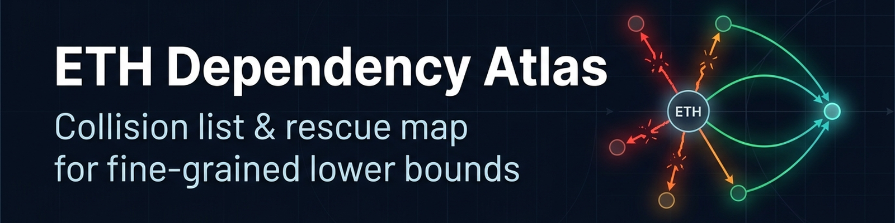

# ETH Dependency Atlas

**A living, open dataset of results that depend on the Exponential Time Hypothesis and related hypotheses, and of what happens to them after the refutations reported in October 2026.**

> **Status: v0.3 (pilot, collision-candidate run, first full-text check).** Living study: entries change as full texts are checked and corrections arrive. **Condition A0:** all classifications assume that the reported refutations are correct. OpenAI and Anthropic independently report deterministic subexponential algorithms for k-SAT (refuting ETH, SETH, Gap-ETH, NSETH and #ETH); Alman and Vassilevska Williams report truly subquadratic 3SUM and truly subcubic APSP. None of this had been independently confirmed as of 2026-11-06.

## What this is

Anthropic's paper notes that more than 800 papers prove at least one result only under ETH or a hypothesis implying it. This atlas maps such results into three products:

| Product | File | Content |
|---|---|---|
| **Collision list** | `data/collisions.csv` | conditional lower bounds that are now **refuted** because an algorithm of that speed exists, each with the colliding result and the encoding argument |
| **Rescue map** | `data/rescues.csv` | conditional results that **still follow** from a hypothesis that is not refuted (e.g. the Orthogonal Vectors Conjecture, or CNF-SAT with unbounded clause width) |
| **Raw atlas** | `data/raw/` | flat, machine-assisted classification of sampled works, for orientation only |

Reference tables: `data/hypotheses.csv` (status of each hypothesis), `data/new_algorithms.csv` (the algorithmic results that define collisions).

## Semantics, please read

A theorem of the form "no 2^{o(n)}-time algorithm for X unless ETH fails" remains **formally true**. *Refuted* here means that the **lower bound it expresses no longer holds**. *Unsupported* means that the hypothesis is gone and the bound is neither proven nor refuted. Nothing in this dataset says that a paper "is wrong".

## Method

Two classifiers from different providers work from title and abstract with an identical brief. Quotes are machine-checked for verbatim presence, and an adjudicator decides disagreements and every refutation. Details: `methods/METHOD.md`, briefs in `methods/`, scripts in `scripts/`, pilot results in `reports/pilot_2026-11-06.md`. Abstracts are not redistributed.

## Corrections welcome

This is a living study. If an entry about your work, or any work, is wrong or incomplete, please open an issue using the **Correction** template (`.github/ISSUE_TEMPLATE/correction.yml`) with the precise statement and, ideally, the reference that settles it. See `CONTRIBUTING.md`.

## Sources

- OAI-ETH = OpenAI, 'The Exponential Time Hypothesis is False' (openai/math@4eaee87548)
- ANT-ETH = Claude (Anthropic), 'A 2^o(n) Time Algorithm for 3-SAT' (anthropics/formal-math@16a5ce4, eth/)
- AVW = J. Alman, V. Vassilevska Williams, arXiv:2610.06783v1
- Bibliographic metadata of the surveyed works: OpenAlex (CC0). Full-text checks use open-access versions only.

## AI disclosure

AI systems were used extensively in this work: literature retrieval and classification, adjudication support, creation and checking of the scripts, evaluation, and text. Quality assurance: independent models from different providers with counter-checks; machine verification that every quote appears verbatim in its source; written adjudication of disagreements; versioned scripts and data; changelog.

## License

Data, documentation and reports: CC BY 4.0 (`LICENSE-DATA`). Scripts: MIT (`LICENSE`). Third-party quotes remain the property of their authors and are used for citation.

## Citation

Please cite the Zenodo record via its concept DOI, which always resolves to the latest version: [10.5281/zenodo.24024060](https://doi.org/10.5281/zenodo.24024060). Version 0.3: [10.5281/zenodo.24024062](https://doi.org/10.5281/zenodo.24024062). See also `CITATION.cff`.
